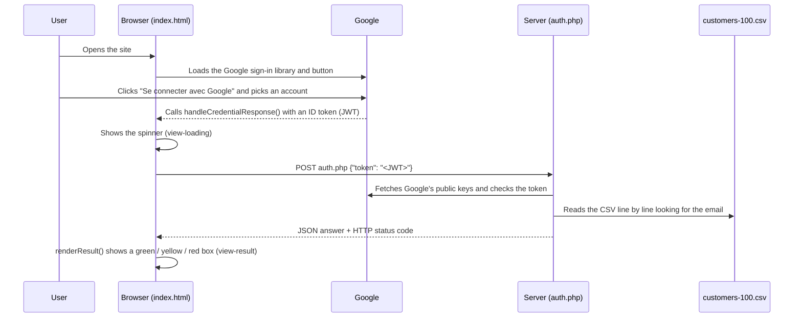

# CAEA website: how it works

This site lets a member of the École Alsacienne sign in with their Google
account and see the information stored for them (right now, the "Website"
column of a CSV file). It has two parts:

- **Front end**: `index.html` + `css/style.css`. This is what runs in the browser.
- **Back end**: `auth.php`. This runs on the server and checks the sign-in
  and looks the user up in the CSV.

There is no database server and no build step. The site is plain HTML, CSS,
JavaScript and one PHP file.

---

## 1. Files

| File | Role |
|---|---|
| `index.html` | The only page. It shows the Google button, sends the token to `auth.php` and displays the answer. |
| `css/style.css` | All styles. The top and bottom parts are the HTML5 Boilerplate; the CAEA styles are in the **"Author's custom styles"** section. |
| `js/app.js` | Empty, kept for future JavaScript. The page logic is currently inside `index.html`. |
| `auth.php` | Back end: verifies the Google token and looks up the email in the CSV. |
| `customers-100.csv` | The data. The first line holds the column names; `auth.php` uses the `Email` and `Website` columns. |
| `composer.json` / `composer.lock` | Declare the PHP dependency `google/apiclient` (the Google library used to verify tokens). |
| `vendor/` | Created by `composer install`. Not in git (see `.gitignore`), so it must be installed on the server. |
| `img/logo_ea.png` | School logo shown in the header. |
| `favicon.ico`, `icon.svg`, `icon.png`, `site.webmanifest` | Browser tab icons and phone "add to home screen" settings. |
| `404.html` | "Page not found" page (boilerplate). |
| `robots.txt` | Currently `Disallow: /`, which asks search engines **not** to index the site. |

---

## 2. The full flow, step by step



### 2.1 In the browser (`index.html`)

1. **Page load.** The `<head>` loads two external scripts:
   - `https://accounts.google.com/gsi/client`: **Google Identity Services**.
     It reads the settings in `<div id="g_id_onload">` and draws the Google
     button inside `<div class="g_id_signin">`.
   - **Shake** (from jsDelivr): the help / bug-report widget opened by the
     "Aide" button.
2. **Three "views".** The white card contains three blocks. The `show(name)`
   function makes one of them visible and hides the others by adding or
   removing the `hidden` class:
   - `view-signin` (step 1): welcome text + Google button.
   - `view-loading` (step 2): spinner while the server is working.
   - `view-result` (step 3): coloured result box + buttons.
3. **Sign-in.** When the user signs in, Google calls the function named in
   `data-callback`, which is `handleCredentialResponse(response)`.
   `response.credential` is the **ID token**: a signed piece of text
   (a JWT) that proves who the user is. The page saves it in `lastToken`
   and calls `sendToken()`.
4. **`sendToken(token)`**:
   - shows the spinner;
   - sends `POST auth.php` with the JSON body `{"token": "…"}`;
   - if the request fails completely (no internet, server down), it shows the
     red **"Connexion impossible"** box;
   - otherwise it tries to read the answer as JSON. If the server sent
     nothing or something that isn't JSON (e.g. a PHP crash), it carries on
     with an empty object, so the page never breaks;
   - it then picks the message from the HTTP status code (table in §3).
5. **`renderResult(kind, title, message, details)`** builds the result box:
   - `kind` sets the colour: `ok` = green, `warn` = yellow, `err` = red;
   - if `details.email` exists, a "Compte" line is added;
   - if `details.website` exists, a "Site web" line is added. It is a
     clickable link **only** if it starts with `http://` or `https://`
     (so a value such as `javascript:…` in the CSV can't become a dangerous link);
   - the **"Réessayer"** (retry) button is shown only for red errors where
     resending the same token could help (network / server errors).
6. **Safety of displayed data.** All text coming from the server is inserted
   with `textContent` (through the `el()` helper), never `innerHTML`. Any HTML
   in the CSV is shown as plain text and never executed.
7. **"Se déconnecter"** (sign out) forgets the token, tells Google not to
   auto-sign-in the same account again (`google.accounts.id.disableAutoSelect()`)
   and goes back to step 1.

### 2.2 On the server (`auth.php`)

1. Loads the Composer autoloader (`vendor/autoload.php`) and announces a JSON
   response.
2. Reads the token from the JSON body (`{"token": …}`) or from a normal form
   field `token`. No token → **400**.
3. Calls `Google_Client->verifyIdToken()`. The library checks that the token:
   - is signed by Google (using Google's public keys, downloaded automatically),
   - is not expired,
   - was issued **for this site** (its audience = `$WEB_CLIENT_ID`),
   - comes from `accounts.google.com`.

   If any check fails → **401**.
4. *(Disabled for now)* Checks that the account belongs to the
   `ecole-alsacienne.org` Google Workspace (the `hd` field of the token).
   Wrong domain → **403**.
5. Takes the verified `email` from the token.
6. Opens `customers-100.csv`, reads the header line, finds the `Email` and
   `Website` columns. File missing → **500** "Unable to open the database";
   column missing → **500** "Required columns not found in CSV".
7. Reads the CSV row by row until a row's `Email` equals the user's email.
   - Found → **200** with the email and website.
   - Not found → **404**.

---

## 3. Server responses and what the page shows

| HTTP code | JSON sent by `auth.php` | Box shown by `index.html` |
|---|---|---|
| 200 | `{"status":"success","email":"…","website":"…"}` | Green **Connexion réussie**, with the email and website |
| 400 | `{"error":"Missing ID token"}` | Red **Session invalide** (no retry button) |
| 401 | `{"error":"Invalid ID token"}` | Red **Session invalide** (no retry button) |
| 403 | `{"error":"Access denied: Invalid domain"}` | Yellow **Accès refusé**, "use your @ecole-alsacienne.org address" |
| 404 | `{"error":"No website found for this email","email":"…"}` | Yellow **Aucun résultat**, with the email |
| 500 | `{"error":"…"}`, or an empty body if PHP crashed | Red **Erreur du serveur** + retry button |
| no reply | (network error) | Red **Connexion impossible** + retry button |

---

## 4. The CSV file

- Comma-separated, first line = column names.
- Required columns: **`Email`** and **`Website`** (exact spelling, case-sensitive).
  Other columns are ignored and can be in any order.
- Emails are compared **exactly**, so `Jean@…` and `jean@…` are different.
  Google always returns the address in lower case, so store emails in lower case.
- To use a different file, change the name in `fopen("customers-100.csv", "r")`
  in `auth.php`.

---

## 5. Setting it up

### 5.1 Requirements

- A web server with **PHP 8.1 or newer** (Apache, Nginx + PHP-FPM, or
  most shared hosting).
- **Composer** to install the Google library.
- The site must be served over **HTTPS** in production (Google sign-in
  requires it, except on `localhost`).

### 5.2 Install

```bash
composer install        # creates the vendor/ folder with google/apiclient
```

Upload the whole folder, **including `vendor/`**, to the server, or run
`composer install` directly on the server.

### 5.3 Google Cloud configuration

The client ID `196751137283-…apps.googleusercontent.com` appears in **two
places that must match**:

- `index.html`: `data-client_id` on `<div id="g_id_onload">`
- `auth.php`: `$WEB_CLIENT_ID`

In the Google Cloud console (APIs & Services → Credentials → this OAuth
client), the site's address must be listed under **Authorized JavaScript
origins**, e.g. `https://your-domain.fr`, plus `http://localhost` and
`http://localhost:8000` for local testing. Without that, the Google button
shows an error.

### 5.4 Run it locally

```bash
composer install
php -S localhost:8000
```

Then open <http://localhost:8000>.

### 5.5 Shake (help button)

The Shake API key is in the last `<script>` of `index.html`
(`Shake.start('…')`). Shake's own floating button is turned off; the page's
"Aide" button opens it instead (`Shake.show()`).

---

## 6. Common changes

- **Allow only school accounts:** in `auth.php`, delete the `/*` and `*/`
  lines around the domain check. Non-school accounts then get a 403 and the
  page shows "Accès refusé".
- **Show another CSV column:** in `auth.php`, find its position like
  `$websiteIndex` (`array_search('ColumnName', $headers)`), add it to the
  success JSON, then in `renderResult()` in `index.html` add a
  `row('Label', el('span', '', details.yourField))` line.
- **Change colours:** edit the variables at the top of the custom section of
  `css/style.css` (`--primary`, `--ok`, …). Every element uses them.
- **Change texts:** all French texts are directly in `index.html`: the
  headings in the HTML, and the result messages in `sendToken()`.

---

## 7. Known issues (to fix before going live)

These come from the code review. Nothing here has been changed yet.

1. **The CSV can be downloaded by anyone.** `customers-100.csv` is in the
   public folder, so `https://your-site/customers-100.csv` returns the whole
   file without signing in. Move it outside the public folder (and update the
   path in `auth.php`), or block it with an `.htaccess` rule.
2. **The domain check is disabled**, so any Google account is accepted (see §6).
   When enabling it, also check `$payload['email_verified']`.
3. **A malformed token crashes `auth.php`.** `verifyIdToken()` throws an
   exception for text that isn't a JWT, and the server returns an empty 500.
   The page handles it ("Erreur du serveur"), but wrapping the call in
   `try { … } catch (Throwable $e) { $payload = false; }` would return a
   proper 401.
4. **Email comparison is case-sensitive** (see §4). Using `strcasecmp()` would fix it.
5. **The CSV path is relative** (`"customers-100.csv"`). Using
   `__DIR__ . '/customers-100.csv'` makes it independent of the server setup.
6. **Shake is loaded as `@latest`.** Pinning a version
   (e.g. `@shakebugs/browser@1.2.3`) avoids surprises when Shake releases an update.
7. **The login isn't remembered.** Each visit signs in again. If more
   protected pages are added, start a PHP session in `auth.php` after a
   successful check.
